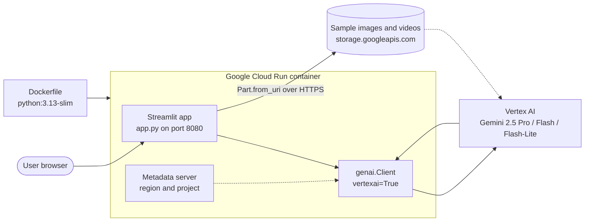
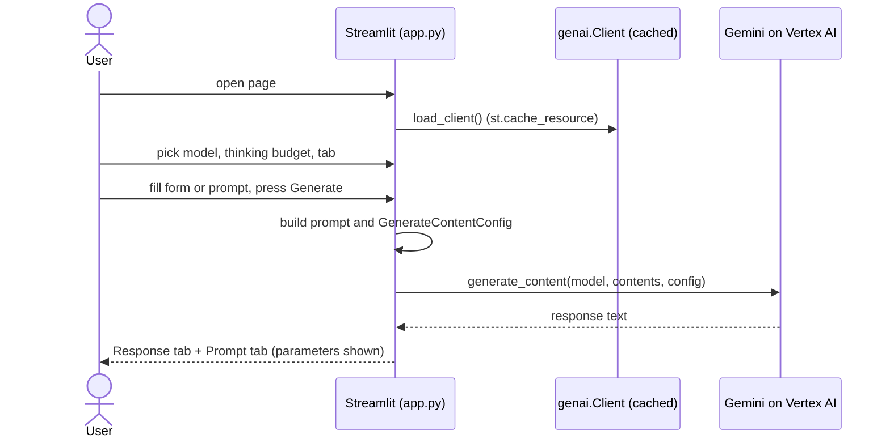
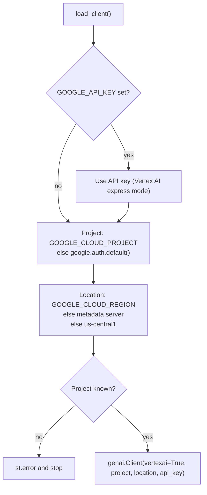

<div align="center">

# Gemini on Cloud Run (Streamlit)

**A multi-tab Streamlit app that calls Gemini through Vertex AI (text, images and video), deployable to Google Cloud Run.**

 -8E75B2?style=for-the-badge&logo=googlegemini&logoColor=white)   

</div>

> **Attribution: this is a Google Cloud sample application, not original work.** It is based on the `gemini-streamlit-cloudrun` sample in [GoogleCloudPlatform/generative-ai](https://github.com/GoogleCloudPlatform/generative-ai/tree/main/gemini/sample-apps/gemini-streamlit-cloudrun) by **Lavi Nigam** and **Holt Skinner**. It was set up as part of the Google Cloud skill badge "Develop GenAI Apps with Gemini and Streamlit". I did not diff the code against upstream, so local changes, if any, are not documented here.

> **Status: learning/sample app.** It has no tests, no authentication and no persistence. The model list, prompts and sample media come from the code; I did not run the app or call the API.

Last updated: 2026-11-03.

---

## Contents

- [What it does](#what-it-does)
- [Repository layout](#repository-layout)
- [Tech stack](#tech-stack)
- [System architecture](#system-architecture)
- [Request flow](#request-flow)
- [Client and configuration resolution](#client-and-configuration-resolution)
- [Run locally](#run-locally)
- [Deploy to Cloud Run](#deploy-to-cloud-run)
- [Security and cost notes](#security-and-cost-notes)
- [Authors and credits](#authors-and-credits)

## What it does

`app.py` renders one Streamlit page with a model selector and five tabs. Every tab builds a prompt and calls `client.models.generate_content(...)`, then shows the result next to the prompt that was sent.

| Control | Details (from `app.py`) |
|---|---|
| Model selector | Radio: `gemini-2.5-flash-lite`, `gemini-2.5-pro`, `gemini-2.5-flash` |
| Thinking budget | Select `Auto`, `Manual` (slider 0 to 24576 tokens) or `Off` (budget 0); sent as `ThinkingConfig` |
| Freeform | Free text prompt; sliders for temperature (0.0-2.0, default 0.5), max output tokens (1-8192, default 2048) and top-p (default 0.95) |
| Generate Story | Form for character, personality, location, premise (multi-select), creativity (maps to temperature 0.30 or 0.95) and length |
| Marketing Campaign | Form for product, audience, goals and other options; fixed temperature 0.8 and 8192 max output tokens |
| Image Playground | Furniture recommendation (room photo + four chair photos), oven instructions, ER diagram explanation, glasses recommendation, math reasoning from an image |
| Video Playground | Video description, tags, highlights and geolocation, using sample videos hosted in a Google Cloud Storage bucket |

Sample images and videos are passed as `Part.from_uri(...)` with HTTPS URLs on `storage.googleapis.com/github-repo/...`, so the app needs outbound internet access to those objects.

## Repository layout

```
gemini-ai-app/
├── app.py              Streamlit app (about 840 lines): client setup, 5 tabs
├── requirements.txt    streamlit, google-genai (unpinned)
├── Dockerfile          python:3.13-slim, installs requirements, runs streamlit on port 8080
├── app.json            Cloud Run button option: allow-unauthenticated = true
├── gemini-streamlit/   Python virtual environment that was committed by mistake (~11k files); ignore it
└── README.md
```

## Tech stack

| Layer | Choice |
|---|---|
| UI | Streamlit |
| LLM SDK | `google-genai` (`genai.Client(vertexai=True, ...)`), types `GenerateContentConfig`, `Part`, `ThinkingConfig` |
| Auth | Google Application Default Credentials via `google.auth`, or an API key for Vertex AI express mode |
| HTTP | `httpx` (metadata-server region lookup; used by the app, installed as a dependency of the SDK, not listed in `requirements.txt`) |
| Runtime | Docker `python:3.13-slim`, port 8080 |
| Hosting | Google Cloud Run (`gcloud run deploy --source=.`) |

<p align="center">
  
</p>

## System architecture



## Request flow



Streamlit reruns the script on each interaction; the client is created once per process thanks to `@st.cache_resource`.

## Client and configuration resolution



| Variable | Meaning |
|---|---|
| `GOOGLE_CLOUD_PROJECT` | Project id; if unset, taken from Application Default Credentials |
| `GOOGLE_CLOUD_REGION` | Vertex AI region; if unset, read from the Cloud Run metadata server, with fallback `us-central1` |
| `GOOGLE_API_KEY` | Optional key for Vertex AI express mode |
| `K_SERVICE` | Set by Cloud Run; the app shows an "Open in Cloud Run" link when present |

## Run locally

Follow `SETUP.md` of the upstream sample first (it is not included in this repository). Then, from this folder, in Cloud Shell or a local shell with Google credentials:

```bash
python3 -m venv gemini-streamlit
source gemini-streamlit/bin/activate
pip install -r requirements.txt

export GOOGLE_CLOUD_PROJECT='<your project id>'
export GOOGLE_CLOUD_REGION='us-central1'      # use a region that supports the models
# or, for Vertex AI express mode:
# export GOOGLE_API_KEY='<your Vertex AI API key>'

streamlit run app.py \
  --browser.serverAddress=localhost \
  --server.enableCORS=false \
  --server.enableXsrfProtection=false \
  --server.port 8080
```

These flags are copied from the upstream instructions for Cloud Shell's web preview. Disabling CORS and XSRF protection is only appropriate for that setup; do not use those flags on a public server. Note the venv name above is the same as the committed `gemini-streamlit/` folder; use a different name (for example `.venv`) to avoid clobbering it.

## Deploy to Cloud Run

[](https://deploy.cloud.run)

```bash
export GOOGLE_CLOUD_PROJECT='<your project id>'
export GOOGLE_CLOUD_REGION='us-central1'
export SERVICE_NAME='gemini-streamlit-app'

gcloud run deploy "$SERVICE_NAME" \
  --port=8080 \
  --source=. \
  --allow-unauthenticated \
  --region=$GOOGLE_CLOUD_REGION \
  --project=$GOOGLE_CLOUD_PROJECT \
  --set-env-vars=GOOGLE_CLOUD_PROJECT=$GOOGLE_CLOUD_PROJECT,GOOGLE_CLOUD_REGION=$GOOGLE_CLOUD_REGION
```

The Cloud Run service account must be allowed to call Vertex AI (see upstream `SETUP.md`). The Dockerfile copies the whole folder (`COPY . ./`), so build context should not include the committed `gemini-streamlit/` virtual environment; add a `.dockerignore` or remove that folder from the repository.

Screenshot from the upstream sample: <https://storage.googleapis.com/github-repo/img/gemini/sample-apps/gemini-streamlit-cloudrun/assets/gemini_pro_text.png>

## Security and cost notes

- **Public by default.** `app.json` and the deploy command use `allow-unauthenticated`. Anyone with the URL can trigger Gemini calls billed to your project. For anything beyond a demo, remove that flag and put Identity-Aware Proxy or Cloud Run IAM in front, and set budgets or quotas.
- **No input handling beyond Streamlit widgets.** User text goes straight into prompts; there is no filtering, rate limiting or logging. Model output is rendered as Markdown. Treat it as untrusted.
- **API key.** If you use `GOOGLE_API_KEY`, keep it in an environment variable or secret manager, never in source.
- **Unpinned dependencies.** `requirements.txt` lists `streamlit` and `google-genai` without versions, and the base image tag is a floating minor; builds are not reproducible. Pin them with a lockfile.
- **Container runs as root** (no `USER` instruction in the Dockerfile) and has no health check.
- **Repo hygiene.** The committed virtual environment (`gemini-streamlit/`) should be removed from git history going forward and added to `.gitignore`.
- **Model names.** The model ids in `MODELS` are as written in the code; verify current availability and pricing in Google's documentation before relying on them.

## Authors and credits

| Authors of the original sample |
|---|
| [Lavi Nigam](https://github.com/lavinigam-gcp) |
| [Holt Skinner](https://github.com/holtskinner) |

This application demonstrates a Cloud Run application that uses the [Streamlit](https://streamlit.io/) framework. Licence and terms are those of the upstream repository.
